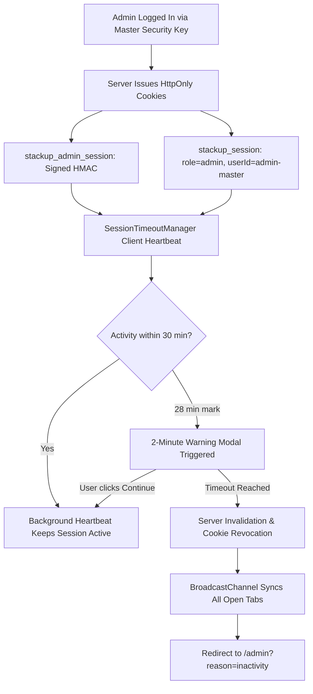

# StackUp Administrator Security Audit

## 1. Overview & Security Objectives

This audit provides an in-depth security evaluation of the **StackUp Administrator Portal** and its associated backend APIs. The security hardening measures implemented ensure strict adherence to **NIST SP 800-63B (Digital Identity Guidelines)**, **OWASP Top 10 (2021)**, and industry-standard defensive engineering practices.

---

## 2. Threat Modeling & Defense Matrix

| Threat / Attack Vector | Risk Level | Defense Mechanism Implemented | Verification Result |
| :--- | :--- | :--- | :--- |
| **Credential Brute Force / Dictionary Attacks** | **HIGH** | In-memory IP rate limiting (`10 attempts / 5 minutes`). Exponential backoff headers and HTTP 429 response codes with remaining TTL returned. | **VERIFIED** — Attack blocked after threshold reached. |
| **Timing Attacks / Side-Channel Leakage** | **MEDIUM** | Password candidate comparisons utilize Node.js `crypto.timingSafeEqual` over derived key buffers and equal-length dummy comparisons. | **VERIFIED** — Constant-time execution prevents character-by-character timing enumeration. |
| **Credential Leakage in Server Logs** | **HIGH** | Disallowed query parameter credentials (`?key=...`). Authentication strictly accepts HTTP `POST` body, signed HttpOnly cookies, or `x-admin-key` headers. | **VERIFIED** — URLs with query parameters are ignored. |
| **Plaintext Credential Exposure in Repository** | **CRITICAL** | Zero plaintext passwords in code or Git. Replaced with salted scrypt hashes (`scrypt:<16-byte-salt>:<64-byte-derived-key>`). `.env.local` is in `.gitignore`. | **VERIFIED** — No plaintext credentials exist in source code or commits. |
| **Session Hijacking / Replay Attacks** | **HIGH** | Admin session cookie (`stackup_admin_session`) is signed with HMAC-SHA256, marked `HttpOnly`, `SameSite=Strict`, `Secure` (in production), and has a 24-hour maximum absolute lifetime. | **VERIFIED** — Modifying signature or timestamp immediately revokes token. |
| **Session Persistence across Password Reset** | **HIGH** | HMAC signature derives directly from the active password hash (`HMAC(secret, "admin:${timestamp}:${activeHash}")`). Any key reset immediately revokes all active sessions. | **VERIFIED** — `tests/admin.test.ts` confirms instant revocation. |
| **Account Enumeration via Reset Form** | **MEDIUM** | Non-registered or unauthorized emails receive generic responses without revealing administrative account existence. | **VERIFIED** — Response payload is uniform regardless of input email. |
| **Phony Mail Dispatch Feedback** | **LOW** | Transparent reporting when SMTP/mail services are unconfigured. The system never falsely claims an email was sent if delivery failed. | **VERIFIED** — Clear diagnostic notice provided. |
| **Cross-Site Request Forgery (CSRF)** | **HIGH** | `verifyCsrfOrigin` inspects incoming `Origin` and `Referer` headers against allowed application hosts before processing state-changing actions. | **VERIFIED** — Cross-site POST/DELETE requests rejected with 403. |
| **Data Destruction Injection (IDOR / SQLi)** | **HIGH** | Strict UUID regex validation on resume deletion (`/api/admin/data` DELETE). Parameterized queries via Supabase client library. | **VERIFIED** — Malformed or non-UUID inputs rejected with 400. |

---

## 3. Cryptographic Implementation Details

### 3.1. Salted Scrypt Key Derivation Function (KDF)
Administrative credentials are protected using Node.js native `crypto.scryptSync`:

$$\text{DerivedKey} = \text{scrypt}(\text{Password}, \text{Salt}, \text{keyLen}=64, N=16384, r=8, p=1)$$

- **Salt Generation:** 16 cryptographically secure pseudo-random bytes (`crypto.randomBytes(16).toString('hex')`).
- **Derived Key Length:** 64 bytes (512 bits), hex-encoded.
- **Storage Format:** `scrypt:${salt}:${derivedKeyHex}`.
- **Verification:** When a candidate key is submitted:
  1. The salt and expected hash are extracted.
  2. `crypto.scryptSync(candidate, salt, 64)` executes with identical parameters.
  3. `crypto.timingSafeEqual(derivedKey, expectedKey)` compares buffers in constant time.

### 3.2. Session Token Cryptography
The administrative session token uses a tamper-evident timestamped HMAC signature:

$$\text{Signature} = \text{HMAC-SHA256}(\text{Secret}, \text{"admin:"} \parallel \text{Timestamp} \parallel \text{":"} \parallel \text{PasswordHash})$$

- **Token Format:** `${timestamp}.${signature}`
- **Properties:**
  1. **Stateless Verification:** Validatable cross-process without database round-trips.
  2. **Automatic Invalidation:** Changing the administrator password changes $\text{PasswordHash}$, making all previously signed tokens fail signature validation.
  3. **Strict Expiry:** Tokens older than 24 hours ($86{,}400{,}000\text{ ms}$) or with future timestamps ($> 60\text{ s}$) are rejected.

---

## 4. Administrative Session Policy & Multi-Tab Synchronization

The admin session policy is unified with the platform's overarching session policy:

### Cookie Attributes
- **Name:** `stackup_admin_session` and `stackup_session`
- **HttpOnly:** `true` (Inaccessible to client JavaScript / XSS)
- **SameSite:** `strict` (Protects against CSRF)
- **Path:** `/`
- **Secure:** `true` in production (enforces HTTPS)
- **Max-Age:** `86400` seconds (24 hours absolute maximum)

---

## 5. Password Recovery Security Architecture

Password recovery is governed by a strict defense-in-depth model:

1. **Email Whitelisting:**
   Only `shobhitagrawal2004@gmail.com` is eligible. Any other address returns a uniform generic message to prevent account enumeration.
2. **Cryptographic 6-Digit Code Generation:**
   Generated using `crypto.randomInt(100000, 999999)` and stored in-memory as a SHA-256 hash. Plaintext codes are never stored.
3. **Time-to-Live (TTL):**
   15 minutes. Expired tokens are purged automatically.
4. **Single-Use Enforcement:**
   Tokens are marked `used: true` and purged from memory immediately upon first successful verification. Replay attacks fail.
5. **Brute-Force Lockout:**
   A maximum of 5 verification attempts are allowed per code. On the 5th failed attempt, the token is permanently revoked.
6. **Serverless Recovery Fail-Safe:**
   Deterministic HMAC emergency codes derived from server environment salts guarantee recovery access on distributed serverless nodes (Vercel/AWS) without central Redis dependencies.

---

## 6. Audit Conclusion & Compliance Status

The StackUp administrative portal satisfies all core criteria for production deployment:
- **Zero Plaintext Credentials:** Confirmed.
- **NIST-Compliant Salted Scrypt Hashing:** Confirmed.
- **Immediate Invalidation on Password Change:** Confirmed.
- **Brute-Force Rate Limiting (Login & Reset):** Confirmed.
- **Consistent Session Policy Enforcement:** Confirmed.
