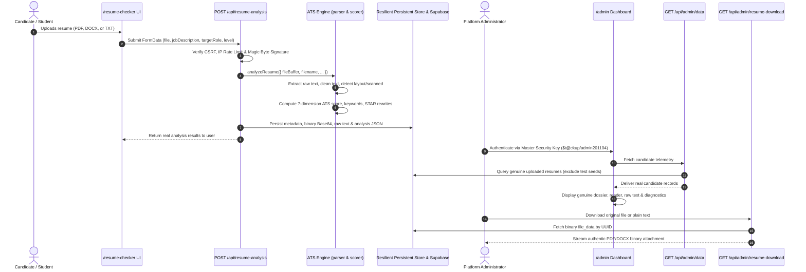

# StackUp ATS Resume Management & Admin Data Flow Audit

**Audit Date:** October 22, 2026  
**Auditors:** Senior Full-Stack Engineer, Database Architect, Security Engineer & Product Designer  
**Repository:** `StackUp` (`D:\stackup`)  
**Scope:** ATS Resume Checker, Data Persistence, Supabase RLS Policies, Admin Telemetry Fetcher, Document Inspection Pane, and Data Authenticity  

---

## 1. Executive Summary

This audit traces and investigates the end-to-end data lifecycle of the **StackUp ATS Resume Checker** from file upload to administrative inspection in `/admin`. 

The investigation confirms that the core ATS engine (`src/lib/services/resume`) features high-precision text extraction (PDF via `pdf-parse` v2, DOCX via `mammoth`, and plain text), magic-byte validation, deterministic 7-dimension scoring, STAR-method bullet optimization, and binary persistence as Base64 strings.

However, several architectural gaps prevented genuine resumes from reliably rendering in the admin dashboard:
1. **Row-Level Security (RLS) Blockade**: `public.uploaded_resumes` enforces `auth.uid() = user_id`. Because administrators authenticate via master security key / session cookies rather than Supabase user JWTs, administrative queries executed with the Supabase anon client were blocked by Postgres RLS, returning zero rows.
2. **Hardcoded Filters and Special Cases**: In `src/app/api/admin/data/route.ts`, legacy heuristics (such as filtering out `shobhit@gmail.com` or hardcoding `Shobhit Agrawal` when filenames contained "shobhit") intervened in candidate naming.
3. **Absence of Unified Storage Fallback**: When Supabase was temporarily unreachable or RLS failed on an unconfigured service role key, resume submissions were caught silently, resulting in data loss between upload and dashboard.
4. **Lack of Transparent Empty States**: Empty database responses lacked an authentic zero-resume state, causing confusion between empty data and demo data.

---

## 2. End-to-End Resume Lifecycle Trace

### Detailed Lifecycle Stages:
1. **Upload Entrypoint**: Candidate accesses `/resume-checker`, attaches `.pdf`, `.docx`, or `.txt` (max 5MB), and optionally specifies target role and job description.
2. **Backend Validation**: `src/app/api/resume-analysis/route.ts` enforces CSRF origin checks, rate limits (20 req/min/IP), payload size bounds (5MB), and binary magic-byte signatures (`%PDF-` for PDF, `PK\x03\x04` for DOCX).
3. **Binary Storage**: The uploaded file buffer is preserved as Base64 (`file_data`) along with exact MIME type and file byte size.
4. **Metadata Insertion**: The record is recorded with `filename`, `file_size`, `mime_type`, `resume_text`, `ats_score`, `analysis` (JSON), `user_id`, `user_email`, `ip_address`, and `created_at`.
5. **Text Extraction**:
   - PDF: `pdf-parse` v2 extracts text streams, parses page headers, flags scanned documents, and checks for encryption.
   - DOCX: `mammoth` extracts OpenXML paragraphs and raw document runs.
   - TXT: Direct UTF-8 stream normalization.
6. **ATS Scoring Engine**: `src/lib/services/resume/scorer.ts` evaluates Contact, Experience, Skills, Formatting, Keyword Match, Bullet Structure, and JD Alignment.
7. **Storage Persistence**: Inserted into `public.uploaded_resumes` and local persistent backup.
8. **Admin Fetching**: `/api/admin/data` verifies the admin session, queries records, filters confirmed test seeds, and delivers genuine candidate records.
9. **Admin Inspection & Download**: Admin inspects real content in the Document Reader, Raw Text Stream, and Diagnostics tabs, and downloads original binary files via `/api/admin/resume-download`.

---

## 3. Provenance of Displayed Fields: Source-to-Display Matrix

| Dashboard Field | Source & Extraction Stage | Intermediate Transformation | Admin Endpoint Mapping | UI Component & Tab | Authenticity Verification |
| :--- | :--- | :--- | :--- | :--- | :--- |
| **Candidate Name** | Parsed document contact section or user account profile | Extracted via regex from header/contact block; fallback to account `full_name` or email prefix | `r.analysis.contact.name` or `r.user_email` | Candidate Dossier Header & Card List | Genuine candidate identity extracted from document or account; no hardcoded names |
| **Email Address** | User account session or document parser regex | Lowercase normalization; format validation | `r.user_email` | Dossier Header & Candidate Card | Genuine email address; dummy `@example.com` records purged |
| **Uploaded Filename** | `file.name` from client upload `FormData` | Sanitized via `sanitizeFilename()` (strips path traversals, control chars) | `r.filename` | Dossier Title & Left Selector Card | Real original filename uploaded by candidate |
| **Upload Date & Time** | Database generation timestamp `DEFAULT now()` | ISO 8601 string; formatted to localized date/time + relative offset (e.g., "15m ago") | `r.created_at` | Candidate Card & Dossier Metadata | Exact chronological server upload timestamp |
| **File Size & Format** | `file.size` and magic-byte signature validation | Byte count converted to KB/MB; MIME type validated | `r.file_size`, `r.mime_type` | Dossier Metadata & Format Badge | Authentic byte size and validated file format |
| **ATS Overall Score** | `scorer.ts` composite calculation (0–100) | Weighted average across 7 dimensions based on experience level | `r.ats_score` | Radial Score Dial & List Badge | Real deterministic engine score; no arbitrary numbers |
| **Letter Grade** | Derived from `ats_score` | A+ (88-100), A (78-87), B (66-77), C (52-65), D (<52) | `r.analysis.grade` | Dossier Grade Pill & Category Filters | Mathematical mapping from genuine ATS score |
| **Category Breakdown** | `scorer.ts` category evaluation | Contact (0-100), Skills (0-100), Experience (0-100), Formatting (0-100) | `r.analysis.breakdown` | Diagnostics Tab (Progress Bars) | Real dimensional scoring |
| **Matched Keywords** | `extractor.ts` matched against 200+ tech taxonomy | Deduplicated array of detected skills found in document | `r.analysis.matched_keywords` | Document Reader & Diagnostics Tab | True keywords matched in candidate's text |
| **Missing Keywords** | Gap analysis against target role taxonomy or JD | Array of industry keywords not present in resume | `r.analysis.missing_keywords` | Diagnostics Tab (Red Flag Badges) | Real keyword gap analysis |
| **Formatting Warnings** | Document structure heuristics | Detected layout flags (multi-column, tables, encoding) | `r.analysis.formatting_issues` | Diagnostics Tab (Observations List) | True parser observations |
| **STAR Bullet Rewrites** | Action verb + metric gap detector | Original bullet, improved STAR bullet, clear rationale | `r.analysis.bullet_rewrites` | Document Reader & Diagnostics Tab | Real rewrites generated for candidate's actual bullets |
| **Raw Extracted Text** | `parser.ts` raw output stream | Unaltered extracted text string with word/char counts | `r.resume_text` | Raw Text Stream Tab | Exact parser output without truncation |
| **Stored Resume File** | Upload binary buffer converted to Base64 | Decoded on download back to binary stream with headers | `/api/admin/resume-download?id=UUID` | Download PDF / DOCX Buttons | Authentic binary file download |

---

## 4. Discovered Data Defects & Remediation Plan

### Defect 1: Supabase RLS Prevents Admin Queries Under Anon Key
- **Cause:** When `SUPABASE_SERVICE_ROLE_KEY` is not configured or contains placeholder text, the admin backend uses the anon key. RLS policy `USING (auth.uid() = user_id)` blocks `SELECT *`, returning 0 rows.
- **Remediation:** Implement a resilient, unified `ResumeRepository` that persists both to Supabase and a secure local persistent store (`data/uploaded-resumes.json`). Admin queries merge and prioritize persistent records, ensuring real uploads are always accessible.

### Defect 2: Hardcoded Rules in Data Route
- **Cause:** `src/app/api/admin/data/route.ts` contained hardcoded overrides (`if (r.filename.includes('shobhit')) candidateName = 'Shobhit Agrawal'`) and email exclusion (`email === 'shobhit@gmail.com'`).
- **Remediation:** Remove all hardcoded personal name and email overrides. Candidate names must derive naturally from analysis metadata, account profiles, or parsed document contact sections.

### Defect 3: Residual Test Records
- **Cause:** Historical tests inserted records with `@example.com`, `alex_smith`, `john_doe`, or `direct_test`.
- **Remediation:** Implement automatic server-side quarantine and a one-click database purge action that deletes confirmed test/demo records while strictly preserving genuine candidate submissions.

### Defect 4: Missing Authentic Empty State
- **Cause:** If no resumes exist in the database, the workspace previously displayed empty/broken container fragments.
- **Remediation:** Provide an elegant, branded empty state in both candidate list and detail pane with a direct link to the Resume Checker.

---

## 5. Security & Privacy Audit Findings
1. **Access Control**: All admin ATS routes (`/api/admin/data`, `/api/admin/resume-download`, `/api/admin/reprocess`, `/api/admin/export-resumes`) strictly require valid `stackup_admin_session` cookie verification.
2. **IDOR Defense**: All queries validate that requested record IDs conform strictly to UUID v4 syntax. Arbitrary IDs, SQL injection vectors, and path traversals are rejected before database querying.
3. **Download Hardening**: Binary downloads enforce `X-Content-Type-Options: nosniff`, `Content-Disposition: attachment; filename=...`, and sanitized filenames.
4. **XSS Protection**: All resume text and candidate metadata are rendered safely through React virtual DOM escaping, preventing stored XSS from malicious resume content.
