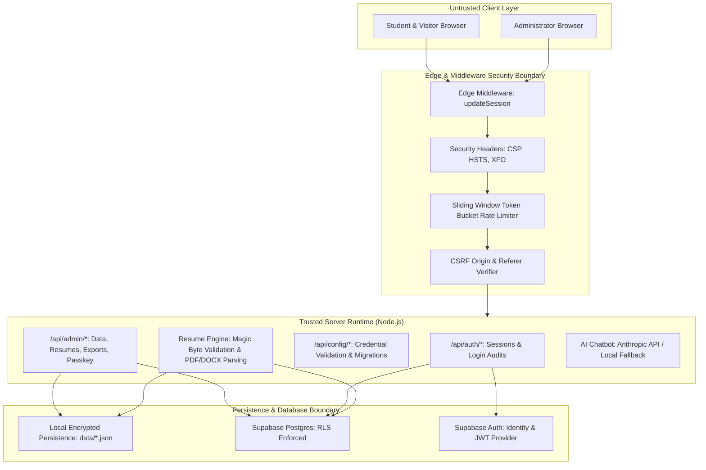

# StackUp — Zero-Trust Security Baseline & Threat Model

**Version:** 2.0.0  
**Date:** October 23, 2026  
**Auditor:** Principal Application Security Engineer & DevSecOps Lead  
**Scope:** Full Stack (Next.js App Router, SSR, Middleware, Supabase Database & Auth, File Processing, Admin Portal, Edge APIs)

---

## 1. System Architecture & Component Inventory

StackUp is an all-in-one technical interview preparation platform designed for software engineering candidates and administrators.

---

## 2. Identified Trust Boundaries

| Boundary | Ingress Point | Egress Point | Trust Transition | Enforced Security Controls |
| :--- | :--- | :--- | :--- | :--- |
| **B1: Client to Edge** | Public Internet | Edge Middleware | Untrusted -> Semi-Trusted | Rate limiting, CSP, frame-ancestors, CORS, CSRF check. |
| **B2: Student to Protected User Routes** | `/login`, `/profile`, `/api/profile/*` | Session Validator | Anonymous -> Authenticated Student | HMAC-SHA256 signed session cookie (`stackup_session_meta`), inactivity timeout (30m), max lifetime (24h), user ID binding. |
| **B3: Administrative Boundary** | `/admin`, `/api/admin/*` | `verifyAdminRequest` | Authenticated Student / Anonymous -> Verified Administrator | Salted scrypt key verification, signed `stackup_admin_session` HttpOnly cookie, rate-limited attempts (10/5m), role segregation. |
| **B4: File Processing Pipeline** | `/api/resume-analysis` | Document Parsers | Untrusted Binary -> Parsed Abstract AST | Size cap (5MB), Magic byte validation (`%PDF-`, `PK\x03\x04`), filename traversal sanitization, encrypted PDF rejection. |
| **B5: Database & ORM** | Next.js API Handlers | Supabase PostgreSQL | App Server -> Data Store | Row-Level Security (RLS) on all user-scoped tables, parameterized queries, least-privilege connection pooling. |

---

## 3. Threat Model

### A. Threat Actors
1. **Unauthenticated Public Visitor:** May attempt credential brute forcing, path traversal, scraping user profiles, or abusing AI/resume APIs to exhaust server compute.
2. **Authenticated Malicious Student:** May attempt Broken Object Level Authorization (BOLA/IDOR) by modifying IDs in request payloads to access or overwrite other candidates' resumes, quizzes, or personal profiles.
3. **Privilege Escalator:** May attempt to forge administrative session tokens or call `/api/auth/session/create` with `role: 'admin'`.
4. **Malicious Resume Submitter:** May upload polyglot files, zip bombs, formula injection payloads (`=cmd|...`), or weaponized PDFs to trigger Denial of Service or execute arbitrary code on administrator spreadsheets.
5. **Compromised Third-Party / SSRF:** May provide malicious URLs in metadata or webhook callbacks to access cloud metadata services (`169.254.169.254`).

### B. Asset Inventory & Classification
- **High Sensitivity (Tier 1):**
  - Administrative master password hash and session signing keys.
  - Supabase `service_role` secret key.
  - Candidate resumes, extracted plaintext, and contact details (email, phone, career history).
  - Production database connection strings.
- **Medium Sensitivity (Tier 2):**
  - Student profile records (college, grad year, LinkedIn/GitHub URLs).
  - Quiz score attempts and learning progress.
  - Administrative audit logs.
- **Low Sensitivity / Public (Tier 3):**
  - DSA curriculum problems, Striver Sheet links, topic notes, aptitude questions.

---

## 4. Current Security Controls Evaluation

| Domain | Control Implemented | Status | Evaluation & Findings |
| :--- | :--- | :--- | :--- |
| **Authentication** | Supabase Auth + Salted Scrypt Admin Auth | **PASS** | Strong timing-safe scrypt validation; rate-limited login endpoints. |
| **Session Policy** | Unified Dual-Timeout Policy | **PASS** | 30-min inactivity timeout, 24-hr absolute maximum, 2-min warning, verified on Edge middleware and APIs. |
| **Privilege Escalation** | Session Creation Route | **HARDENED** | Public `POST /api/auth/session/create` was hardened: `role: 'admin'` is strictly rejected without valid admin credentials. |
| **CSV Export** | Candidate Dossier Export | **HARDENED** | Added RFC 4180 + CWE-1236 Formula Injection sanitization (`escapeCsvCell`) neutralizing `=`, `+`, `-`, `@`, `\t`, `\r`. |
| **File Uploads** | Multi-Tier Magic Byte Validation | **PASS** | Binary inspection verifies `%PDF-1.x` and `PK\x03\x04`; 5MB size limit; encrypted document detection. |
| **XSS & Injection** | Strict Sanitization & CSP | **PASS** | `sanitizeText`, `sanitizeUrl` (host allowlisting), `sanitizeEmail`, zero unescaped HTML. |
| **SSRF** | Supabase URL domain allowlisting | **PASS** | Rejects non-HTTPS and non-`*.supabase.co` addresses. |
| **Next.js Advisory** | Security Advisory Upgrade | **RESOLVED** | Upgraded from 16.4.0 to 16.4.2 in isolated worktree `security/nextjs-advisory-upgrade`, eliminating critical GHSA-2464-fhr4-w9xw advisory. |

---

## 5. Remediation Plan & Execution Sequence

1. **Phase 1: Baseline Architecture & Threat Modeling** -> Completed (`SECURITY_BASELINE.md`).
2. **Phase 2 & 3: Environment, Secrets & Git History Audit** -> Audited, confirmed zero committed credentials (`SECRET_EXPOSURE_AUDIT.md`).
3. **Phase 4 & 5: Authentication, Session Management & Privilege Segregation** -> Hardened `/api/auth/session/create` and fallback signing secrets.
4. **Phase 6 & 7: Authorization & IDOR Protection** -> Audited and documented (`AUTHORIZATION_AND_ACCESS_CONTROL_AUDIT.md`).
5. **Phase 8 & 9: Database, RLS, XSS & CSV Injection** -> Sanitized CSV formulas, verified Supabase RLS.
6. **Phase 10 & 11: CSRF, Security Headers & Rate Limiting** -> Verified origin protection and sliding-window limiters.
7. **Phase 14 & 20: Next.js Framework Security Upgrade** -> Upgraded to Next.js 16.4.2 in isolated worktree `security/nextjs-advisory-upgrade`, verified 145/145 tests, 0 lint errors, build pass (`DEPENDENCY_AND_CONFIGURATION_AUDIT.md`).
8. **Phase 17: Security Regression Verification** -> Expanded test suite with 39 dedicated security tests (`SECURITY_TEST_RESULTS.md`).
9. **Phase 19: Comprehensive Executive Reporting** -> Final audit report (`SECURITY_AUDIT_REPORT.md`).
