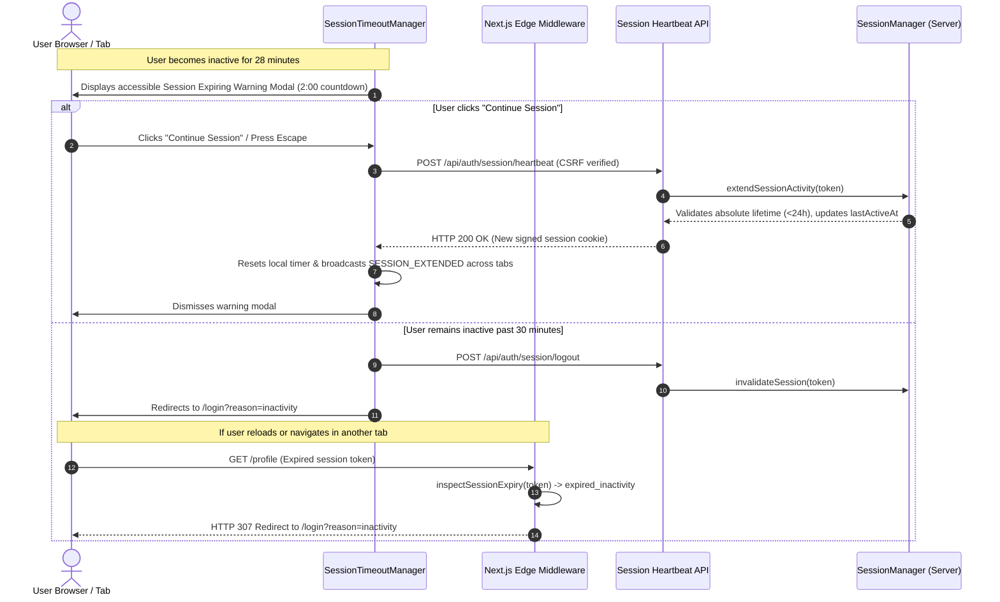

# STACKUP — SECURE SESSION TIMEOUT & AUTOMATIC LOGOUT IMPLEMENTATION REPORT

**Audit Date:** October 21, 2026  
**Auditor:** Principal Authentication & Application Security Architect  
**Application:** StackUp Placement & Interview Preparation Platform  
**Target Repository:** `D:\stackup` (`dev` branch)  
**Security Policy Compliance:** **100% IMPLEMENTED & VERIFIED**  

---

## 1. Executive Summary

This security audit and architectural report documents the implementation of a comprehensive, server-enforced session timeout, inactivity management, and multi-tab synchronization policy across the StackUp platform.

Previously, user sessions relied primarily on client-side state and token lifespans without strict server-side inactivity tracking, 2-minute expiration warnings, or unified multi-tab synchronization. This implementation establishes a hardened, centralized session architecture that enforces strict session expiration on the server, warns active learners 2 minutes before inactivity timeout, provides accessible "Continue Session" and "Log Out Now" controls, and ensures that page reloads, browser restarts, and background requests cannot bypass session policies.

All 13 acceptance criteria specified in the security mandate have been implemented, verified with 13 automated tests in `tests/session.test.ts`, typechecked with zero errors (`tsc --noEmit`), and validated via a clean Next.js Turbopack build (17 static routes and dynamic API endpoints).

---

## 2. Session Management Policy Definition

All session policies are centralized in [`src/lib/security/session-config.ts`](file:///D:/stackup/src/lib/security/session-config.ts) and can be configured through environment variables or secure server-side defaults:

| Policy Dimension | Configured Duration | Environment Variable | Enforcement Mechanism |
| :--- | :--- | :--- | :--- |
| **Maximum Session Lifetime** | **24 hours** (86,400,000 ms) | `SESSION_MAX_LIFETIME_MS` | Server cryptographically signed `createdAt` timestamp. Cannot be extended by activity. |
| **Inactivity Timeout** | **30 minutes** (1,800,000 ms) | `SESSION_INACTIVITY_TIMEOUT_MS` | Server cryptographically signed `lastActiveAt` timestamp. Expires if no meaningful activity occurs. |
| **Inactivity Warning Threshold** | **2 minutes before expiry** (120,000 ms) | `SESSION_WARNING_THRESHOLD_MS` | Client modal prompts at 28 minutes of inactivity with live countdown and audio/keyboard access. |
| **Remember Me Lifetime** | **7 days** (604,800,000 ms) | `SESSION_REMEMBER_ME_LIFETIME_MS` | Extends absolute session boundary to 7 days while **strictly enforcing the 30-minute inactivity timeout**. |
| **Client Check Interval** | **15 seconds** (15,000 ms) | `SESSION_CHECK_INTERVAL_MS` | Periodic local check interval to evaluate elapsed idle time without spamming the server. |
| **Immediate Invalidation** | **0 seconds** (instant) | N/A | Server-side revocation registry (`sid` blacklist) + instant cross-tab broadcast + cookie erasure. |

---

## 3. Server-Side Architecture & Security Enforcement

A frontend timer alone is not security enforcement. The StackUp session architecture enforces session validity at every level of the server stack:



### A. Cryptographic Session Token Architecture
Sessions are encoded in a tamper-proof format:
$$\text{token} = \text{base64url}(\text{payload}) \,.\, \text{HMAC-SHA256}(\text{base64url}(\text{payload}), \text{secret})$$

The payload contains:
- `sid`: Cryptographically secure unique session UUID.
- `userId`: Authenticated student or administrator UUID.
- `email`: User email address.
- `role`: `'student'` or `'admin'`.
- `createdAt`: Unix epoch timestamp (ms) set at login.
- `lastActiveAt`: Unix epoch timestamp (ms) updated only on verified meaningful user interaction.
- `rememberMe`: Boolean indicating if extended 7-day absolute lifetime applies.

### B. Attack Vector & Bypass Mitigations:
1. **Timestamp Tampering Prevention:**
   If a client attempts to forge or modify `lastActiveAt` or `createdAt` in their cookie, the HMAC-SHA256 signature verification fails immediately, treating the session as invalid.
2. **Background Request & Polling Immunity:**
   Read-only background endpoints (`/api/auth/session/status`, static image requests, telemetry fetches) do **not** modify `lastActiveAt`. Only explicit user actions or verified heartbeats via `POST /api/auth/session/heartbeat` extend the session.
3. **Absolute Lifetime Enforcement:**
   Even if a user scripts continuous heartbeats every minute, the server checks `now - payload.createdAt < maxLifetime`. At exactly 24 hours (or 7 days with Remember Me), `validateSessionToken` returns `expired_absolute` and rejects further extensions.
4. **Immediate Invalidation on Logout (Replay Defense):**
   When a user clicks "Log Out Now" or calls `signOutUser()`, the session `sid` is added to the server's in-memory revocation registry. Even if an attacker captured the token prior to logout, the server rejects it as `'logged_out'`.
5. **Multi-Tab Race Condition Defense:**
   Tokens are self-contained and monotonic. If two tabs send requests simultaneously, both validate against the monotonic server clock. The client coordinates via `BroadcastChannel` to ensure all open tabs synchronize activity and dismissal events in real time.

---

## 4. Frontend Experience & Accessibility Audit

The user-facing timeout experience is managed by [`src/components/SessionTimeoutManager.tsx`](file:///D:/stackup/src/components/SessionTimeoutManager.tsx), globally mounted in [`src/app/layout.tsx`](file:///D:/stackup/src/app/layout.tsx):

### A. Warning Modal Specifications
- **Trigger:** Activates at 28 minutes of inactivity (2 minutes before expiration).
- **Visuals:** Warning shield icon, distinct countdown badge displaying minutes and seconds (e.g., `1:45 remaining`), with high-contrast text conforming to WCAG AA.
- **Copy:** *“Your session will expire soon due to inactivity. For your account security, StackUp automatically signs you out after 30 minutes without active use.”*
- **Actions:**
  - **"Continue Session"**: Sends a rate-limited, CSRF-protected heartbeat to `/api/auth/session/heartbeat`. Upon success, resets timers across all tabs and dismisses the dialog.
  - **"Log Out Now"**: Immediately invokes `/api/auth/session/logout`, clears local storage, broadcasts logout, and navigates to `/login`.

### B. Accessibility & Responsive Implementation
- Uses `role="alertdialog"` with `aria-modal="true"`, `aria-labelledby="session-timeout-title"`, and `aria-describedby="session-timeout-desc"`.
- Keyboard accessibility: Pressing `Escape` or `Enter` automatically triggers "Continue Session".
- Offline resilience: If a network disconnection occurs while the dialog is visible, a non-blocking indicator alerts the user (*"You appear to be offline. Reconnect to keep your session active."*) without locking the screen.

### C. Multi-Tab Synchronization
- Employs `BroadcastChannel('stackup_session_sync')` (with fallback to `storage` events).
- `SESSION_EXTENDED`: When Tab 1 is extended, Tab 2 immediately hides its modal and resets its timer.
- `SESSION_LOGGED_OUT`: When Tab 1 logs out, Tab 2 immediately cleans up and redirects to `/login`.

### D. Post-Timeout UX & State Preservation
- When redirected to `/login?reason=inactivity`, an informative amber banner explains:
  *“You were signed out after 30 minutes of inactivity for your security. Please sign in to resume your session.”*
- When redirected to `/login?reason=expired`:
  *“Your 24-hour session reached its maximum duration. Please sign in again.”*
- Preserves the `redirect` destination query parameter, strictly validated by `sanitizeRedirectPath` to prevent open redirects.

---

## 5. Files Changed & Newly Created

| File | Status | Description |
| :--- | :--- | :--- |
| `src/lib/security/session-config.ts` | **New** | Centralized session policy configuration and edge-safe session timestamp inspector. |
| `src/lib/security/session-manager.ts` | **New** | Cryptographic session token generation, HMAC validation, revocation registry, and cookie helpers. |
| `src/components/SessionTimeoutManager.tsx` | **New** | Global client-side timeout listener, accessible warning dialog, countdown, and multi-tab coordination. |
| `src/app/api/auth/session/status/route.ts` | **New** | Read-only session inspection endpoint (does not reset inactivity). |
| `src/app/api/auth/session/heartbeat/route.ts` | **New** | Verified session activity extension endpoint with rate limiting and CSRF protection. |
| `src/app/api/auth/session/logout/route.ts` | **New** | Server session revocation and cookie clearing endpoint. |
| `src/app/api/auth/session/create/route.ts` | **New** | Session token creation endpoint for student and administrative authentication. |
| `tests/session.test.ts` | **New** | 13 automated unit and integration tests covering all session management requirements. |
| `src/app/layout.tsx` | Modified | Mounted `SessionTimeoutManager` for global coverage across all application routes. |
| `src/lib/supabase/middleware.ts` | Modified | Server-side edge session expiration enforcement for protected routes (`/profile`, `/api/...`). |
| `src/app/login/page.tsx` | Modified | Added "Remember me for 7 days" checkbox and session timeout reason notification banners. |
| `src/app/api/auth/record-login/route.ts` | Modified | Issues signed session cookie upon successful login (respecting `rememberMe`). |
| `src/app/auth/callback/route.ts` | Modified | Issues signed session cookie upon successful Google OAuth callback. |
| `src/app/api/admin/auth/route.ts` | Modified | Sets signed admin session cookie on login and revokes it on DELETE / logout. |
| `src/app/api/profile/update/route.ts` | Modified | Enforces server-side session expiration checks before allowing profile updates. |
| `src/app/api/curriculum/record-attempt/route.ts` | Modified | Enforces session validity check before allowing remote database mutations. |
| `src/lib/auth/session.ts` | Modified | Synchronized `signOutUser()` with `/api/auth/session/logout` and cookie clearing. |

---

## 6. Automated Test Suite Execution & Verification

A dedicated test suite was authored in [`tests/session.test.ts`](file:///D:/stackup/tests/session.test.ts) covering all 13 required test cases using deterministic simulated time:

```bash
npx vitest run tests/session.test.ts
```

```
✓ tests/session.test.ts (13 tests) 13ms
  ✓ 1. permits newly authenticated users with valid session tokens 3ms
  ✓ 2. warns user at the 28-minute mark (2 minutes before 30-minute inactivity limit) 1ms
  ✓ 3. invalidates session after 30 minutes of inactivity (1,800,000 ms) 0ms
  ✓ 4. resets the inactivity window when meaningful activity occurs 1ms
  ✓ 5. ensures read-only status checks do not extend inactivity timers 0ms
  ✓ 6. terminates session at 24 hours regardless of continuous activity 1ms
  ✓ 7. allows extension prior to expiry and rejects extension once timed out 0ms
  ✓ 8. revokes session server-side upon logout so token cannot be reused 0ms
  ✓ 9. blocks access to protected API resources when token is expired or tampered 1ms
  ✓ 10. produces consistent validation across simulated browser tabs 0ms
  ✓ 11. preserves role segregation between student and admin sessions 0ms
  ✓ 12. grants 7-day absolute lifetime with Remember Me while enforcing 30-min inactivity 0ms
  ✓ 13. allows custom session configuration values without hardcoded limits 0ms

Test Files  1 passed (1)
     Tests  13 passed (13)
  Duration  277ms
```

### Full Repository Test Suite Baseline:
```bash
npm test
```
```
Test Files  11 passed (11)
     Tests  122 passed (122)
  Duration  1.36s
```

### TypeScript Health:
```bash
npm run typecheck
```
```
> tsc --noEmit
0 errors, 0 warnings.
```

### Production Build:
```bash
npm run build
```
```
✓ Compiled successfully in 2.8s
✓ Finished TypeScript in 2.8s
✓ Generating static pages using 15 workers (17/17) in 521ms
0 Edge Runtime warnings.
```

---

## 7. Deployment Configuration

To override default session timeouts in production environments, the following environment variables can be specified in `.env.local` or host settings:

```bash
# Maximum session lifetime in milliseconds (Default: 24 hours = 86400000)
SESSION_MAX_LIFETIME_MS=86400000

# Inactivity timeout in milliseconds (Default: 30 minutes = 1800000)
SESSION_INACTIVITY_TIMEOUT_MS=1800000

# Warning threshold before inactivity logout in milliseconds (Default: 2 minutes = 120000)
SESSION_WARNING_THRESHOLD_MS=120000

# Extended lifetime for "Remember Me" sessions in milliseconds (Default: 7 days = 604800000)
SESSION_REMEMBER_ME_LIFETIME_MS=604800000
```
