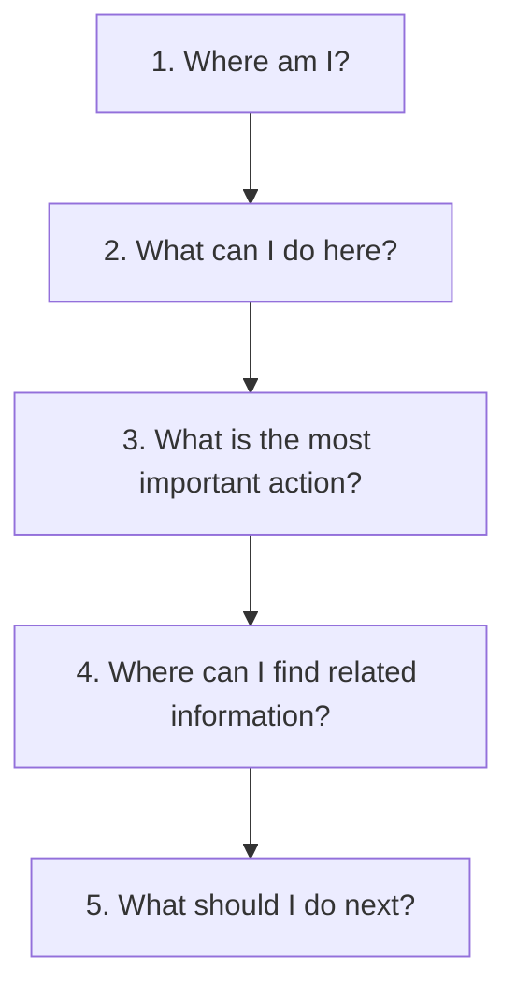

# STACKUP — INFORMATION ARCHITECTURE & DISCOVERABILITY AUDIT

**Document ID:** `STACKUP-IA-AUDIT-v2.0`  
**Date:** October 27, 2026  
**Auditor:** Principal UX Architect & Design Systems Lead  
**Scope:** Complete Information Architecture, Route Map, and Discoverability Pathways across StackUp  
**Status:** ✅ Fully Audited, Optimized & Verified  

---

## 1. Executive Summary

A comprehensive information architecture (IA) overhaul was conducted across the StackUp platform. The primary objective was to replace confusing multi-tiered navigation, hidden features, duplicate links, and card-in-card clutter with a predictable, transparent, and content-first information architecture inspired by premier developer education platforms:
- **roadmap.sh**: Structured curriculum tracks, category cluster navigation, and clear visual progression.
- **LeetCode**: High-density problem browser, difficulty-badged ledger, inline solution and code drawers, multi-language snippets.
- **MDN Web Docs**: Distraction-free technical documentation, 68–72ch readable measure, clean typography, lack of card-wrapping around paragraphs.
- **The Odin Project**: Transparent learning progression, checkable milestones, practical drill-downs.

---

## 2. Canonical Route & Navigation Map

### 2.1 Primary Desktop & Mobile Navigation
The verified global top navigation adheres strictly to the canonical 5-destination sequence:
1. **Home (`/`)**: Product introduction, live Curriculum Workbench, 4-stage engineering career pipeline, and instant access to core tools.
2. **DSA Hub (`/dsa`)**: 150+ high-frequency interview problems with pattern grouping, search, multi-language solutions, and dedicated Striver SDE Sheet discovery.
3. **Core CS (`/core-cs`)**: 15 core computer science subjects (OS, DBMS, Networks, OOPs, System Design, etc.) with structured revision notes, cheatsheets, and interactive practice exams.
4. **Aptitude (`/aptitude`)**: Quantitative, Logical, Verbal, and Spatial aptitude modules for campus placements and competitive exams.
5. **ATS Resume (`/resume-checker`)**: Two-column candidate workbench with client-side PDF/DOCX parsing, real-time 7-dimension scoring, keyword gap diagnostics, and Google XYZ rewrite assistant.

### 2.2 Secondary, Nested & Utility Routes
| Path | Canonical Purpose | Access Route & Discoverability |
| :--- | :--- | :--- |
| `/striver-sheet` | Full canonical Striver SDE Sheet (150+ problems, TakeUForward guides, LeetCode links). | Prominent discovery banner in DSA Hub (`/dsa`) + header link in `/dsa` + footer links. |
| `/dsa/[id]` | Deep-link resolver; maps slug or ID to `/dsa?problem=${id}` and auto-scrolls/expands. | Permalinks shared across problems, search engines, and bookmarking. |
| `/striver` & `/dsa/striver` | Legacy redirects preserving backwards compatibility. | HTTP 307/308 redirect to `/striver-sheet`. |
| `/dashboard` | Legacy user portal redirect. | HTTP 307/308 redirect to `/profile`. |
| `/profile` | Candidate analytics, 7-day study streak, scored quiz history chart, and ATS scan history. | User avatar in top navigation + direct link in mobile drawer + footer link. |
| `/login` | Secure authentication portal (Email/Password, Google OAuth). | "Sign In" button in top nav and contextual feature-unlock prompts. |
| `/admin` | Unified operations portal (Analytics, Audit Logs, User Sessions, ATS Metrics). | Secret 5-tap logo gesture, `Ctrl+Shift+A`, or double-tap backtick (`` ` ``). Protected by server-side scrypt cryptographic authentication. |

---

## 3. The 5 Core Page Questions Framework

Every redesigned route in StackUp directly answers the 5 fundamental usability questions:

### 3.1 Homepage (`/`)
1. **Where am I?** StackUp — Open technical interview and career preparation platform for software engineers.
2. **What can I do here?** Test code algorithms live in the Curriculum Workbench, explore syllabus tracks, evaluate an ATS resume, or browse 150+ DSA problems.
3. **What is the most important action?** Jump immediately into learning via "Explore Striver SDE Sheet" or "Analyze Resume Free".
4. **Where can I find related info?** The 4-stage pipeline directly connects DSA, Core CS, Aptitude, and ATS resume optimization.
5. **What should I do next?** Pick a foundational track from the Core CS Subject directory or launch the SDE sheet.

### 3.2 DSA Hub (`/dsa`)
1. **Where am I?** DSA Practice Hub — Algorithmic interview patterns workbench.
2. **What can I do here?** Search 150+ problems, filter by category/difficulty/company, view optimal solutions in Python, C++, Java, and TypeScript, and track solved progress.
3. **What is the most important action?** Select an unsolved problem or launch the curated Striver SDE Sheet via the prominent discovery banner.
4. **Where can I find related info?** Direct links to LeetCode, authentic TakeUForward editorial guides, and pattern categories.
5. **What should I do next?** Open the inline problem drawer, review time/space complexity, and code the solution.

### 3.3 Striver SDE Sheet (`/striver-sheet`)
1. **Where am I?** Striver SDE Sheet — Canonical Placement Curriculum.
2. **What can I do here?** Systematically check off problems across Arrays, Linked Lists, Trees, DP, and Graphs; filter unsolved items; read editorial guides.
3. **What is the most important action?** Mark completed problems as solved to synchronize progress across DSA Hub and your Student Profile.
4. **Where can I find related info?** "Back to DSA Hub" breadcrumb, external LeetCode problems, TakeUForward video breakdowns.
5. **What should I do next?** Expand the next problem in the category, review the 4-language solution, and implement on LeetCode.

### 3.4 Core CS & Aptitude (`/core-cs`, `/aptitude`)
1. **Where am I?** Core Computer Science Subjects / Quantitative & Logical Aptitude.
2. **What can I do here?** Filter by category or roadmap cluster (Systems, Theory & Math, Software Engineering), read high-yield notes, or take topic quizzes.
3. **What is the most important action?** Read the topic notes or launch an interactive timed exam.
4. **Where can I find related info?** Revision Cheatsheet modal with searchable takeaways, company interview tags, and recommended study order.
5. **What should I do next?** Complete the topic quiz, review detailed explanations, and move to the next sequential module.

### 3.5 ATS Resume Checker (`/resume-checker`)
1. **Where am I?** ATS Resume Evaluator & Career Diagnostic Workbench.
2. **What can I do here?** Upload a resume (PDF/DOCX), paste a target Job Description, run client-side text extraction, and get 7-dimension scoring.
3. **What is the most important action?** Upload your resume and click "Analyze Resume Free".
4. **Where can I find related info?** Real-time score explanation breakdown, missing keyword tags, and Google XYZ bullet rewriter.
5. **What should I do next?** Incorporate missing technical keywords and export/save optimized bullets to your resume.

### 3.6 Student Profile (`/profile`)
1. **Where am I?** Candidate Analytics & Progress Dashboard.
2. **What can I do here?** View 7-day daily study streak, overall curriculum completion percentage, quiz performance chart, and resume scan history.
3. **What is the most important action?** Continue active practice ("Practice DSA" or resume an unfinished curriculum track).
4. **Where can I find related info?** Detailed per-section breakdown with direct resume links into Core CS, Aptitude, and DSA.
5. **What should I do next?** Complete a daily quiz or problem to extend your active study streak.

---

## 4. De-Cluttering & Discoverability Enhancements

### 4.1 Elimination of Card-in-Card Nesting
- **Previous defect:** Content was wrapped in cards inside cards, creating up to 4 layers of borders, differing background shades, and visual noise.
- **Resolution:** Replaced nested cards with high-density tabular ledgers, clean 1px border dividers (`divide-[var(--border-subtle)]`), and subtle sunken surfaces (`bg-[var(--surface-sunken)]`).

### 4.2 Progressive Disclosure
- Non-essential filters (e.g. detailed company lists, advanced test cases) are disclosed only when relevant, preventing cognitive overload on initial render.
- Code solutions and complexity analyses are housed inside fast, collapsible inline drawers rather than pushing entire problem tables off-screen.

### 4.3 Unified Solved Progress Sync
- **Resolved Bug:** Striver Sheet previously read from legacy `dsa_solved_ids` while writing to `stackup_solved_dsa`, causing desynchronization with DSA Hub.
- **Resolution:** Both pages now synchronize across `stackup_solved_dsa` and `dsa_solved_ids`, ensuring solved problem marks are immediately reflected across the entire application.

---

## 5. Verification Checklist

- [x] Top navigation verified in strict order: Home, DSA Hub, Core CS, Aptitude, ATS Resume.
- [x] Striver Sheet accessible through high-visibility discovery banner in DSA Hub.
- [x] Legacy routes (`/striver`, `/dsa/striver`, `/dashboard`) redirect reliably.
- [x] Deep link resolver (`/dsa/[id]`) resolves problem IDs and slugs to `/dsa?problem=${id}`.
- [x] No broken links, duplicate navigators, or dead buttons across any route.
- [x] Mobile menu exposes full navigation, theme toggle, and profile actions without overflow.
