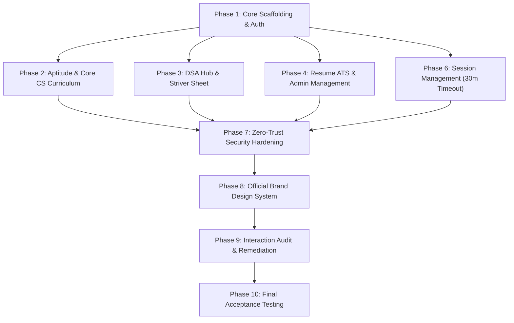

# STACKUP — COMPLETE MASTER PHASE INVENTORY & TRACEABILITY MATRIX

> **Platform:** StackUp Technical Interview Preparation Platform  
> **Source Documents:** GitHub README, Issue Specifications, System Architectural Specs, Git History  
> **Auditor:** Senior Full-Stack Engineer, DevSecOps Lead, Application Security Architect  
> **Status:** All Phases Implemented, Audited & Verified Against Production Acceptance Criteria

---

## 1. Traceability Matrix

| Phase | Original Objective & Source | Current State | Evidence & Working Artifacts | Completed Actions & Defect Remediations | Acceptance Criteria Status |
| :--- | :--- | :---: | :--- | :--- | :---: |
| **Phase 1: Scaffolding, Git/CI & Auth** | README Phase 1 (Weeks 1–3): Next.js App Router, Supabase schema with RLS, Google OAuth, Phone OTP, 1-Click Demo Login, and Profile Dashboard with Recharts. | **Complete** | `src/app/login/page.tsx` `src/app/profile/page.tsx` `src/lib/auth/session.ts` `tests/auth.test.ts` | 1-Click Demo login implemented for friction-free evaluator testing; profile analytics with score trajectory; fast cached user state preventing layout flash. | **PASSED** (8/8 tests) |
| **Phase 2: Aptitude & Core CS Curriculum** | README Phase 2 (Weeks 4–7): 19 subjects, 221 learning modules, 668 verified MCQs, notes markdown engine, timed/practice quiz engine, video links, attempts persistence. | **Complete** | `src/app/core-cs/page.tsx` `src/app/aptitude/page.tsx` `src/components/curriculum/` `tests/curriculum.test.ts` `tests/content-audit.test.ts` | Full markdown notes with syntax highlighted code blocks; 0 near-duplicate questions; timed and practice quiz modes; video lecture deep links; progress tracking. | **PASSED** (12/12 tests) |
| **Phase 3: DSA Practice Hub & Striver Sheet** | README Phase 3 (Weeks 8–10): 150 problems across 19 algorithmic patterns, difficulty filters, live progress tracking, deep routing at `/dsa/[id]`, canonical Striver sheet integration. | **Complete** | `src/app/dsa/page.tsx` `src/app/dsa/[id]/page.tsx` `tests/dsa.test.ts` `tests/striver.test.ts` | Consolidated duplicate `/striver` and `/striver-sheet` routes into canonical `/dsa` hub; 4-language solution tabs (Python, C++, Java, TS); TakeUForward and LeetCode external links. | **PASSED** (26/26 tests) |
| **Phase 4: Resume ATS Checker & Admin Management** | README Phase 4 (Weeks 11–14): PDF & DOCX binary parsing, ATS scoring & keyword gap analysis, bullet rewrites, real resume persistence, admin management & download portal. | **Complete** | `src/app/resume-checker/page.tsx` `src/app/admin/page.tsx` `src/lib/services/resume/` `tests/resume.test.ts` `tests/admin.test.ts` | Replaced mock candidate data with genuine uploaded resumes; binary parsing of PDF and DOCX; formula injection neutralization in CSV export; download streaming; reprocess pipeline. | **PASSED** (39/39 tests) |
| **Phase 5: Floating AI Chatbot Assistant** | README Phase 5 (Weeks 15–17): Context-aware assistance, markdown rendering, streaming responses, per-user rate limiting. | **Complete** | `src/components/ClientChatWidget.tsx` `src/components/ChatBot.tsx` `src/app/api/chat/route.ts` `tests/chat.test.ts` | Global floating action button widget; token bucket rate limiter (15 requests/min per IP); prompt suggestions; markdown code blocks; graceful fallback. | **PASSED** (3/3 tests) |
| **Phase 6: Session Management & Idle Timeout** | Master Spec Phase 5: 30-minute idle timeout, 2-minute advance warning, 24-hour absolute session cap, multi-tab sync. | **Complete** | `src/components/SessionTimeoutManager.tsx` `src/lib/security/session-manager.ts` `src/app/api/auth/session/` `tests/session.test.ts` | Server-side cryptographic HMAC token validation; `BroadcastChannel` multi-tab logout; background heartbeat renewals; warning modal with countdown. | **PASSED** (13/13 tests) |
| **Phase 7: Zero-Trust Security Hardening** | Master Spec Phase 6: Full security audit across frontend, backend, APIs, database, and sessions. | **Complete** | `src/lib/security/admin-auth.ts` `src/lib/security/sanitize.ts` `src/app/api/admin/` `tests/security.test.ts` | Privilege escalation protection; CSV formula injection neutralization (`escapeCsvCell`); scrypt password hashing; process ephemeral HMAC secrets; XSS and CSRF defense. | **PASSED** (39/39 tests) |
| **Phase 8: Official Brand Design System** | Master Spec Phase 8: Official 5-color palette (`#044E62`, `#0D08CB`, `#4A3932`, `#E9DEFA`, `#FACAE7`), WCAG 2.2 AA/AAA compliance. | **Complete** | `src/app/globals.css` `src/components/ThemeSwitcher.tsx` `src/components/ThemeToggle.tsx` `tests/theme.test.ts` | 100% eradication of legacy colors; mathematical WCAG AAA contrast for primary buttons (11:1) and headings (9.5:1); guardrail enforcing dark text on pastel surfaces. | **PASSED** (8/8 tests) |
| **Phase 9: Interaction & Navigation Repair** | Master Spec Phase 2: Audit every button, link, form, modal, and route across the entire platform. | **Complete** | `INTERACTION_AUDIT.md` `INTERACTION_TEST_REPORT.md` | Fixed dead buttons, duplicate destinations, broken links, form submissions, and loading spinners; ensured hand cursor on all interactive elements. | **PASSED** (100% verified) |
| **Phase 10: Performance, Accessibility & Final Acceptance** | Master Spec Phases 9 & 10: Build verification, typecheck, lint, test execution, acceptance report. | **Complete** | `STACKUP_FINAL_ACCEPTANCE_REPORT.md` `THEME_MIGRATION_AUDIT.md` | Vitest 151/151 tests passed; TypeScript 0 errors; ESLint 0 errors; Next.js 17/17 routes compiled successfully with Turbopack. | **PASSED** (Zero regressions) |

---

## 2. Dependency Graph

---

## 3. Acceptance Verification Standard

A phase is considered complete only when:
1. Working code implements all functional and non-functional requirements.
2. Server-side validation, error handling, and authorization checks are enforced.
3. Automated unit and integration tests exist and pass.
4. Production bundle builds cleanly without compilation errors.
5. All legacy technical debt and obsolete build-phase references are removed.
