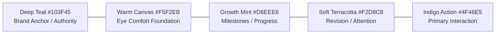

# STACKUP — DESIGN SYSTEM SPECIFICATION (WARM EDITORIAL)

> **Document:** Design System Architecture, Token Hierarchy & Component Standards  
> **Date:** November 23, 2026  
> **Version:** 2.0 (Warm Editorial Engineering)  
> **Target:** Multi-breakpoint consistency across Desktop, Tablet, and Mobile

---

## 1. DESIGN SYSTEM OVERVIEW & PHILOSOPHY

StackUp's visual identity balances **scholarly authority** with **human approachability**. It discards cold, generic AI dashboard templates and marketplace SaaS cards in favor of a warm, editorial, and focused study workspace.

### Core Principles:
1. **Restraint Over Decoration:** Avoid excessive gradients, floating decorative blurs, and nested card syndrome.
2. **Reading Comfort First:** Soft off-white canvas backgrounds reduce photopic eye strain during multi-hour code reading sessions.
3. **Intentional Feedback:** Colors serve semantic purposes (e.g., `#D6EEE6` growth mint for milestone badges, `#F2D8C8` terracotta for revision alerts, `#4F46E5` indigo for focal CTAs).

---

## 2. COLOR PALETTE & SEMANTIC TOKENS

### 2.1 The Seven Canonical Tokens

| Token Name | Hex Value | Primary Role | Contrast vs. Canvas | WCAG Compliance |
| :--- | :--- | :--- | :--- | :--- |
| `deep-teal` | `#103F45` | Brand identity, headings, core navigation anchors | 10.9:1 | AAA |
| `warm-canvas` | `#F5F2EB` | Background canvas, card contrast foundation | Base Canvas | N/A |
| `growth-mint` | `#D6EEE6` | Solved badges, milestone tags, positive streaks | 1.3:1 (Surface) | Decorative / Badge BG |
| `soft-terracotta` | `#F2D8C8` | Flashcard alerts, weak area revision prompts | 1.2:1 (Surface) | Decorative / Alert BG |
| `indigo-action` | `#4F46E5` | Primary CTA buttons, active radio options, focus rings | 6.28:1 | AA |
| `text-primary` | `#242C2A` | Primary editorial body copy & titles | 12.7:1 | AAA |
| `text-muted` | `#6B736F` | Secondary timestamps, author metadata, labels | 4.5:1 | AA |

### 2.2 Semantic Color Mapping

| Semantic State | Light Theme Token | Dark Theme Token | Purpose |
| :--- | :--- | :--- | :--- |
| **Page Background** | `#F5F2EB` | `#0E1719` | Top-level document canvas |
| **Card Surface** | `#FFFFFF` | `#142225` | Primary content container |
| **Elevated Surface** | `#FAF8F5` | `#1B2E32` | Dropdowns, popovers, active dialogs |
| **Sunken Surface** | `#EAE5DC` | `#0A1113` | Code snippet background, test case wells |
| **Subtle Border** | `#DFD9CE` | `#233B40` | Divider lines, card outlines |
| **Strong Border** | `#C5BDB0` | `#325259` | Hover borders, active tab outlines |
| **Success / Solved** | `#16A34A` / `#D6EEE6` | `#22C55E` / `#103F45` | Accepted verdicts, complete milestones |
| **Warning / Attention**| `#D97706` / `#F2D8C8` | `#F59E0B` / `#382618` | Time limits, revision alerts, hint tags |
| **Error / Failed** | `#DC2626` / `#FEE2E2` | `#EF4444` / `#3B181E` | Compile errors, wrong answers |

---

## 3. TYPOGRAPHY SYSTEM

StackUp uses two primary typefaces:
- **Primary Sans:** `Plus Jakarta Sans` (Geometric, clean, highly legible at small sizes).
- **Code Mono:** `JetBrains Mono` (Ligatures, tabular numbers, unambiguous 0/O and 1/l).

### Type Hierarchy Scale

| Role | Font Family | Size / Line Height | Weight | Tracking |
| :--- | :--- | :--- | :--- | :--- |
| **Display H1** | `Plus Jakarta Sans` | `32px - 40px / 1.2` | 800 (Extrabold) | `-0.025em` |
| **Section H2** | `Plus Jakarta Sans` | `24px - 28px / 1.3` | 700 (Bold) | `-0.02em` |
| **Card H3** | `Plus Jakarta Sans` | `18px - 20px / 1.4` | 700 (Bold) | `-0.015em` |
| **Subhead H4** | `Plus Jakarta Sans` | `14px - 16px / 1.4` | 600 (Semibold) | `0em` |
| **Body Large** | `Plus Jakarta Sans` | `15px - 16px / 1.6` | 400 (Regular) | `0em` |
| **Body Standard**| `Plus Jakarta Sans` | `13px - 14px / 1.5` | 400 / 500 | `0em` |
| **Caption / Meta**| `Plus Jakarta Sans` | `11px - 12px / 1.4` | 500 / 600 | `+0.01em` |
| **Code Block** | `JetBrains Mono` | `12px - 13px / 1.6` | 400 / 500 | `0em` |

---

## 4. SPACING, ELEVATION & SHADOWS

- **Base Grid:** 4px grid system (`space-1` = 4px, `space-2` = 8px, `space-4` = 16px, `space-6` = 24px, `space-8` = 32px).
- **Border Radii:**
  - Micro tags / pills: `rounded-md` (6px)
  - Interactive inputs / buttons: `rounded-lg` (8px) to `rounded-xl` (12px)
  - Cards & modals: `rounded-2xl` (16px)
- **Restrained Elevation:**
  - Standard cards: `shadow-2xs` (`0 1px 2px 0 rgba(0, 0, 0, 0.04)`)
  - Hover states: `shadow-xs` (`0 2px 4px 0 rgba(0, 0, 0, 0.06)`)
  - Dropdowns & dialogs: `shadow-md` (`0 4px 12px -2px rgba(0, 0, 0, 0.12)`)

---

## 5. INTERACTION & COMPONENT STATES

Every interactive component adheres to 6 discrete visual states:
1. **Default:** Crisp border with high contrast against the local surface.
2. **Hover:** Subtle background shift (`bg-[var(--surface-sunken)]/60`), border darkening, and 150ms transition.
3. **Focus:** Visible `ring-2 ring-[var(--brand-action)] ring-offset-2` outline.
4. **Active / Pressed:** Subtle scale `active:scale-[0.98]`.
5. **Loading:** Animated spinner icon (`Loader2`) with disabled cursor and preserved layout width.
6. **Disabled:** 50% opacity, `cursor-not-allowed`, zero pointer events.

---

## 6. RESPONSIVE BREAKPOINT ARCHITECTURE

| Breakpoint | Minimum Width | Layout Adaptations |
| :--- | :--- | :--- |
| **Mobile S** | `320px` | Single-column stack, collapsible drawer, bottom action bar |
| **Mobile Standard** | `375px - 430px` | Full touch target boundaries ($\ge 44\text{px}$), horizontal chip scrollers |
| **Tablet** | `768px` | 2-column curriculum cards, side-by-side POTD summary |
| **Desktop** | `1024px` | Split-pane coding IDE (50/50 resizable), persistent sidebar |
| **Widescreen** | `1440px+` | Constrained reading containers ($\le 75\text{ch}$) to prevent neck strain |

---
*StackUp Design System Version 2.0 fully landed and integrated in `src/app/globals.css`.*
