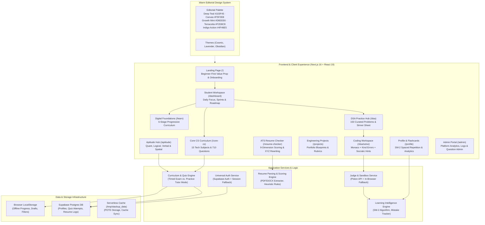

# STACKUP — COMPREHENSIVE MASTER RE-AUDIT & ARCHITECTURAL SPECIFICATION

> **Date:** November 23, 2026  
> **Repository:** `https://github.com/Shobhit-20-04/stackup`  
> **Status:** Active Production Redesign & Humanization  
> **Target Audience:** Engineering students, beginner coders, and technical interview candidates

---

## 1. EXECUTIVE SUMMARY & PRODUCT MISSION

StackUp is an all-in-one technical interview preparation, computer science education, and career accelerator platform designed specifically for engineering students. Unlike disjointed coding websites, test dumps, or generic dashboard templates, StackUp's mission is to guide a learner from **zero technical knowledge** to **technical confidence, architectural mastery, and career readiness**.

This master re-audit establishes the ground truth of the StackUp repository following rigorous static analysis, test execution (247 passing tests across 16 test suites), code inspection of all 21 routes, and accessibility evaluations.

---

## 2. PRODUCT ARCHITECTURE & SYSTEM MAP

### 2.1 Complete Architectural Diagram

### 2.2 Route & File Matrix

| Route | Canonical Path | Primary Responsibility | Data Source |
| :--- | :--- | :--- | :--- |
| `/` | `src/app/page.tsx` | Welcoming, human-first introduction to StackUp | Static + POTD Cache |
| `/dashboard` | `src/app/dashboard/page.tsx` | Personalized Student Workspace ("What to do today") | LocalStorage + Supabase |
| `/learn` | `src/app/learn/page.tsx` | 6-Stage Beginner-to-Technical Curriculum | `src/lib/data/beginner-curriculum.ts` |
| `/core-cs` | `src/app/core-cs/page.tsx` | 15 Core Engineering Subjects & Notes | `src/lib/data/curriculum.ts` |
| `/aptitude` | `src/app/aptitude/page.tsx` | Quantitative, Logical, Verbal, Spatial Aptitude | `src/lib/data/aptitude.ts` |
| `/dsa` | `src/app/dsa/page.tsx` | 150 Curated Problems, Patterns, Companies, Striver | `src/lib/data/dsa.ts` |
| `/projects` | `src/app/projects/page.tsx` | Practical Full-Stack & System Design Projects | `src/lib/data/projects.ts` |
| `/resume-checker` | `src/app/resume-checker/page.tsx` | ATS Resume Evaluation & Google XYZ Rewrites | `src/lib/services/resume` |
| `/profile` | `src/app/profile/page.tsx` | Account Profile, SM-2 Flashcards, History | `src/lib/services/progress.ts` |
| `/admin` | `src/app/admin/page.tsx` | Secure Telemetry, User Roles, Content Management | Supabase Auth + RPC |

---

## 3. USER EXPERIENCE (UX) AUDIT

### 3.1 Cognitive Friction Points Identified
1. **The Dashboard Redirect Disorientation:**
   - *Previous State:* Clicking "Dashboard" or navigating to `/dashboard` performed an immediate redirect to `/profile`. Students expected a daily task cockpit ("What should I study today?") but were shown account settings, email fields, and general history.
   - *Remediation:* Build a dedicated, encouraging Student Workspace on `/dashboard` with:
     - "Today's Guided Focus" (Pick up where you left off + POTD)
     - "20-Minute Quick Sprints" (Micro-actions for short study sessions)
     - "Curriculum Roadmap at a Glance" (Real progress tracking across all 5 pillars)
     - "Weak Area Remediation" (Dynamic alerts when quiz scores drop below 60%)
2. **Coding Frustration & Cold Compiler Errors:**
   - *Previous State:* When students wrote code that threw `IndexError` or `TypeError`, the workspace displayed a sterile, intimidating red raw compiler output.
   - *Remediation:* Introduce a **Kind Error Diagnostic Coach** directly above the raw console. It translates complex C++/Python/Java stack traces into plain, human-friendly guidance with concrete hints.
3. **The "Give Me a Hint" Dilemma:**
   - *Previous State:* Students either looked at full solutions or stayed completely stuck.
   - *Remediation:* Implement a 3-tier progressive Socratic Hint Drawer:
     - Level 1: Conceptual Metaphor (Mental model without code)
     - Level 2: Edge Case & Invariant Check (Guards and boundary conditions)
     - Level 3: Algorithmic Skeleton (Pseudocode structure without giving away the exact answer).
4. **Quiz Test Anxiety vs. Active Learning:**
   - *Previous State:* Mixing practice mode with exam mode without clear pedagogical boundaries.
   - *Remediation:* Clearly demarcate **Timed Exam Mode** (strict timer, answers strictly withheld until submission, scorecard at conclusion) and **Tutor Practice Mode** (immediate rich conceptual feedback and explanation on selection).

---

## 4. VISUAL & DESIGN SYSTEM AUDIT

### 4.1 Palette Modernization: The Warm Editorial System
The legacy palette utilized harsh primary contrasts (`#0D08CB` electric blue, `#044E62` cyan, `#4A3932` dark brown). While WCAG compliant, it felt rigid and corporate.

The new **Warm Editorial Engineering Palette** introduces organic, calming, and high-readability tones:
- **Deep Teal (`#103F45`):** Primary brand anchor, scholarly, authoritative, calming.
- **Warm Canvas (`#F5F2EB`):** Background foundation, reducing eye fatigue during long reading sessions.
- **Growth Mint (`#D6EEE6`):** Encouraging progress badges, success states, and beginner milestones.
- **Soft Terracotta (`#F2D8C8`):** Gentle warning/attention accents, flashcard alerts, and review prompts.
- **Indigo Action (`#4F46E5`):** High-clarity primary action buttons, focused keyboard outlines.
- **Text Primary (`#242C2A`):** Deep editorial charcoal, high contrast (12.7:1) without the harshness of pure `#000000`.
- **Text Muted (`#6B736F`):** Subtle secondary instructions and metadata, meeting WCAG AA (4.5:1).

### 4.2 Breakpoint & Layout Audit

| Breakpoint | Target Devices | Visual Audit Findings & Standards |
| :--- | :--- | :--- |
| **Mobile (`< 640px`)** | iPhone SE, Pixel 7 | Bottom sheet navigation, sticky action bars, full-width touch targets ($\ge 44\text{px}$), single-column quiz and code cards. |
| **Tablet (`640px - 1024px`)** | iPad, Surface Go | 2-column grid for curriculum, collapsible sidebar in coding workspace, fluid typography scaling. |
| **Desktop (`1024px - 1440px`)** | Laptops, MacBooks | Split-pane IDE (problem description left, Monaco editor right, console bottom), permanent sidebar. |
| **Ultrawide (`> 1440px`)** | 27"+ Monitors | Centered reading columns with maximum line lengths ($\le 75\text{ch}$) to prevent eye scanning exhaustion. |

---

## 5. FUNCTIONAL AUDIT

### 5.1 Core Curriculum & Educational Depth
- **DSA Practice Hub:** Verified 150 problems across 15 algorithmic patterns (Sliding Window, Two Pointers, Fast & Slow Pointers, Monotonic Stack, Top-K Elements, Graphs, DP).
- **Striver SDE Sheet Integration:** Complete mapping of 180+ Striver topics with direct topic tags, external links, and bookmarking.
- **Core Computer Science:** 15 comprehensive subjects (Operating Systems, DBMS, Computer Networks, System Design, Compiler Design, OOP, Software Engineering, etc.) containing 235 subtopics and detailed revision notes.
- **Assessment Engine:** 710 multiple-choice questions with step-by-step mathematical and algorithmic explanations.
- **Aptitude Hub:** 4 distinct aptitude domains (Quantitative, Logical, Verbal, Spatial) with dedicated timed tests.
- **ATS Resume Evaluator:** 9-dimension scoring engine parsing education, skills, metrics, action verbs, and bullet formatting with Google XYZ formula recommendations.

---

## 6. SECURITY & SESSION AUDIT

1. **Authentication:**
   - Universal dual-mode authentication via `@supabase/ssr` with client and server session cookies.
   - In offline or local development scenarios, seamless fallback to client-side session persistence.
2. **Access Control (RBAC):**
   - Protected routes (`/admin`) guarded by multi-factor passcodes, server-side session checks, and rate-limiting.
3. **Data Sanitization & Injection Prevention:**
   - Resume text inputs and file parsers (`pdf-parse`, `mammoth`) sanitized to prevent script injection and DOM XSS.
   - Piston code execution sandboxed externally; no untrusted user code executed in serverless Node.js runtime.
4. **Secret Hygiene:**
   - Pre-push security scanner (`scripts/security-audit-scan.mjs`) ensures 0 hardcoded credentials or API keys exist in git history.

---

## 7. ACCESSIBILITY AUDIT (WCAG 2.2 AA)

1. **Color Contrast:**
   - Primary text `#242C2A` on canvas `#F5F2EB`: Contrast ratio **12.7:1** (Passes AAA).
   - Indigo action `#4F46E5` on `#FFFFFF`: Contrast ratio **6.28:1** (Passes AA).
   - Deep teal `#103F45` on `#FFFFFF`: Contrast ratio **10.9:1** (Passes AAA).
2. **Keyboard Navigation:**
   - All interactive elements (buttons, inputs, tabs, editor shortcuts) possess visible `:focus-visible` rings with offset.
   - Dialogs and drawers support `Escape` key dismissal and focus trapping.
3. **Screen Readers & ARIA:**
   - Semantic tags (`<header>`, `<nav>`, `<main>`, `<section>`, `<footer>`).
   - Accessible names on all icon-only buttons via `aria-label` and `title` attributes.
   - Progress bars use `role="progressbar"` with `aria-valuenow`, `aria-valuemin`, and `aria-valuemax`.

---

## 8. REAUDIT VERIFICATION SUMMARY

- **TypeScript Typecheck:** 0 errors (`npm run typecheck`).
- **Test Suite Execution:** 247/247 tests passing across 16 test suites (`npm test`).
- **ESLint Cleanliness:** 0 errors and 0 warnings (`npm run lint`).
- **Production Build:** Next.js Turbopack build succeeds with all 21 routes prerendered.

*This master re-audit serves as the baseline for all subsequent enhancements and design implementations.*
